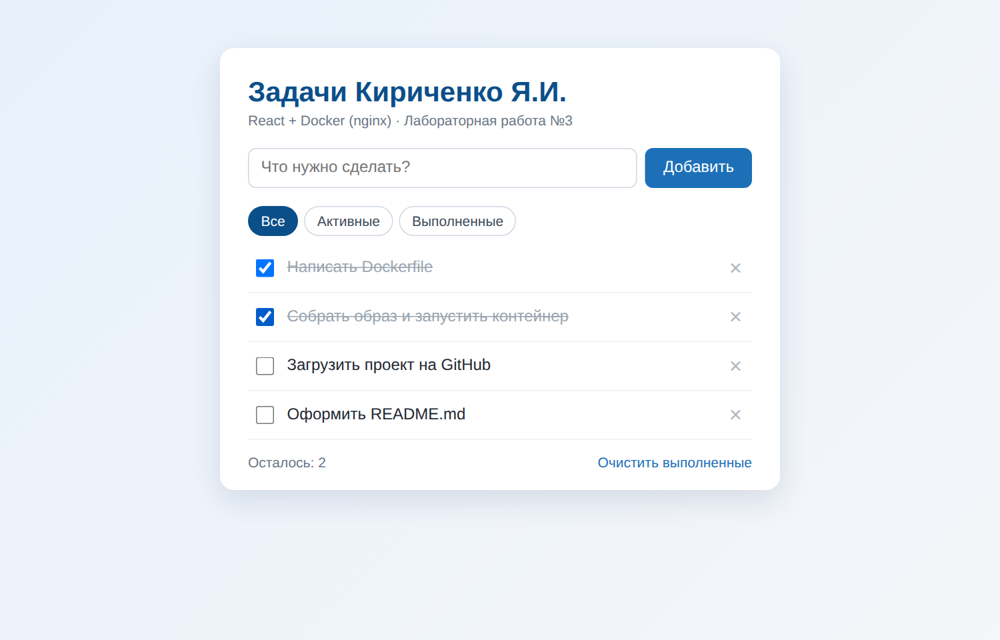

# React ToDo в Docker

Простое React-приложение «Список задач» (ToDo), упакованное в Docker-образ с помощью многоступенчатой сборки: на первом этапе `node:alpine` собирает статику (`npm run build`), на втором `nginx:alpine` раздаёт готовые файлы.

Возможности приложения:

- добавление новой задачи;
- отметка задачи как выполненной;
- фильтры «Все», «Активные», «Выполненные»;
- удаление задачи и очистка выполненных;
- сохранение списка в `localStorage` браузера.

Лабораторная работа №3, МДК 08.01 «Проектирование и разработка интерфейсов пользователя». Исполнитель — Кириченко Я.И.

## Скриншот

Приложение, открытое в браузере после запуска контейнера (`http://localhost:8080`):



## Структура проекта

```
react-todo-docker/
├── public/                  # статические файлы React (index.html, иконки)
├── src/                     # исходный код приложения (App.js, App.css)
├── docs/screenshot.png      # скриншот для README
├── Dockerfile               # многоступенчатая сборка node:alpine -> nginx:alpine
├── .dockerignore            # исключения из контекста сборки
├── nginx.conf               # конфигурация nginx (SPA, gzip, кэширование)
├── docker-compose.yml       # запуск через Docker Compose
├── .env.example             # пример переменных окружения
├── .github/workflows/       # GitHub Actions: сборка образа при пуше в main
├── package.json
└── README.md
```

## Требования

- установленный [Docker Desktop](https://www.docker.com/products/docker-desktop/) (Windows / macOS) или Docker Engine (Linux);
- для локального запуска без Docker — Node.js 18+.

## Сборка Docker-образа

```bash
docker build -t react-todo-docker .
```

## Запуск контейнера

```bash
docker run -d -p 8080:80 --name react-todo react-todo-docker
```

Здесь `8080` — порт на хосте (можно указать любой свободный), `80` — порт nginx внутри контейнера.

## Адрес приложения

После запуска откройте в браузере: **http://localhost:8080**

## Запуск через Docker Compose

```bash
docker-compose up -d
```

(в новых версиях Docker — `docker compose up -d`). Остановка: `docker-compose down`.

## Переменные окружения

Заголовок приложения и порт можно изменить без правки кода.

При сборке образа:

```bash
docker build --build-arg REACT_APP_TITLE="Мои задачи" -t react-todo-docker .
```

Через Docker Compose — скопируйте `.env.example` в `.env` и измените значения:

```
APP_PORT=8080
REACT_APP_TITLE=Список задач
```

## Остановка и удаление контейнера

```bash
docker stop react-todo && docker rm react-todo
```

## Запуск в Windows одним кликом

- `ЗАПУСК.bat` — собирает образ, запускает контейнер и открывает браузер;
- `ОСТАНОВКА.bat` — останавливает и удаляет контейнер.

## Локальный запуск без Docker

```bash
npm install
npm start
```

Приложение будет доступно по адресу http://localhost:3000.
